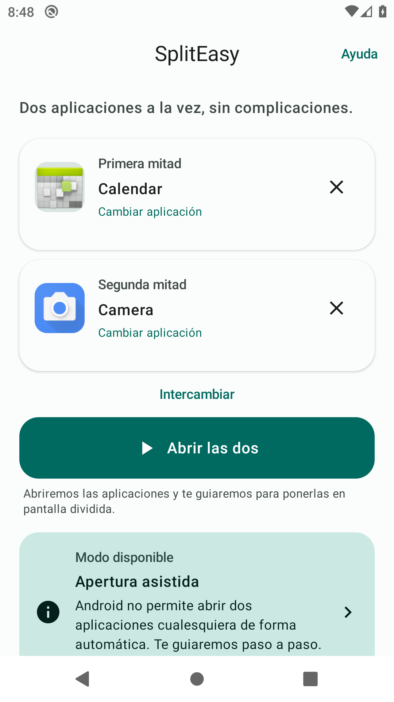
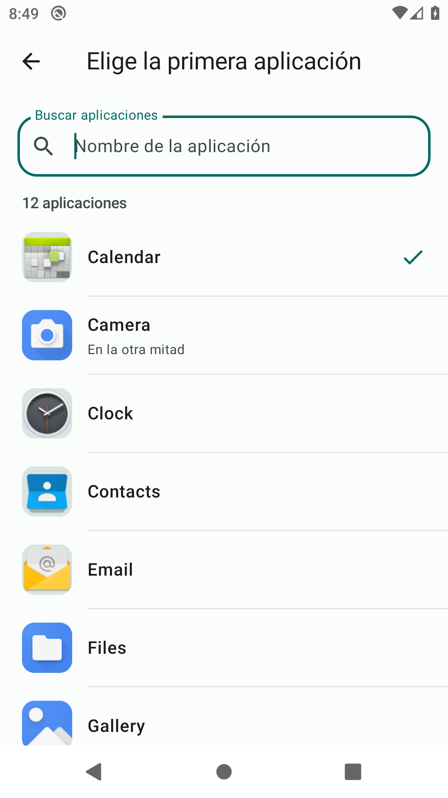
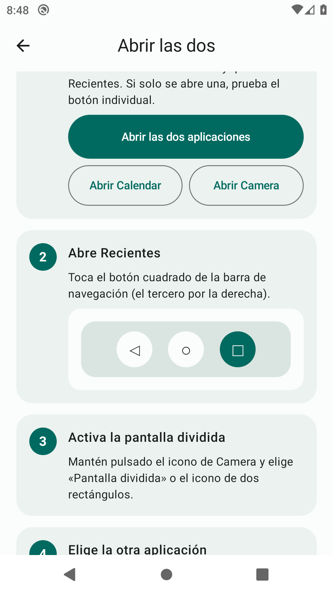
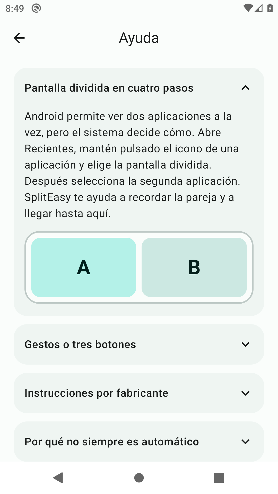
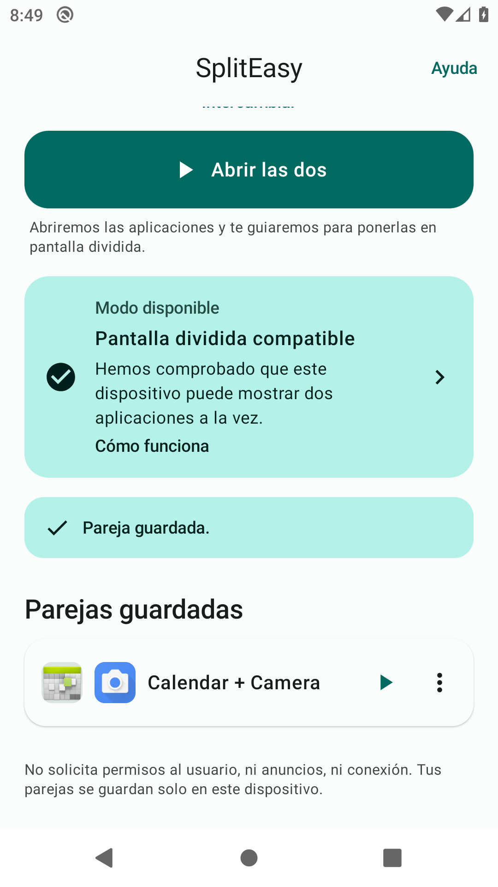
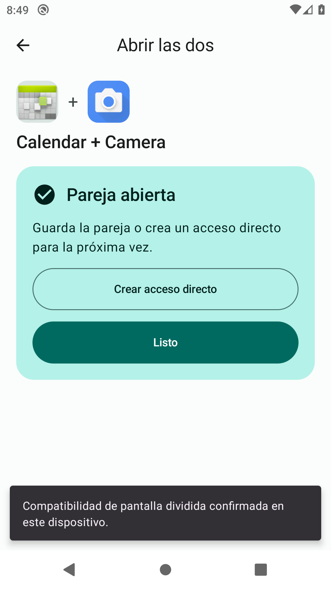
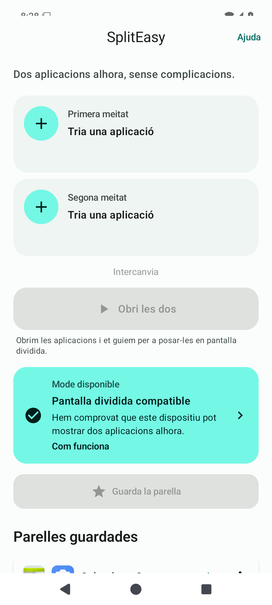
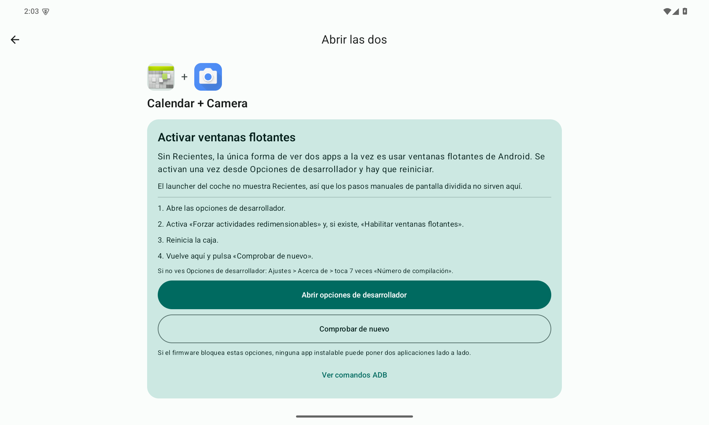
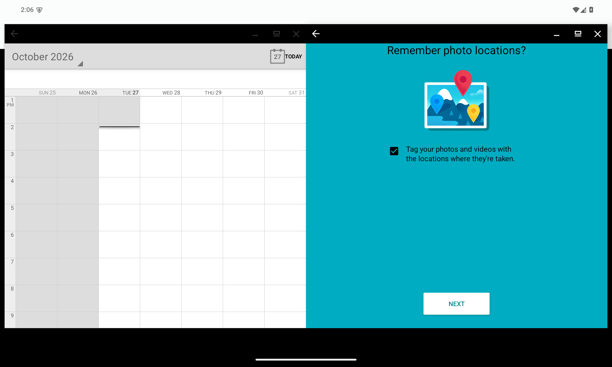
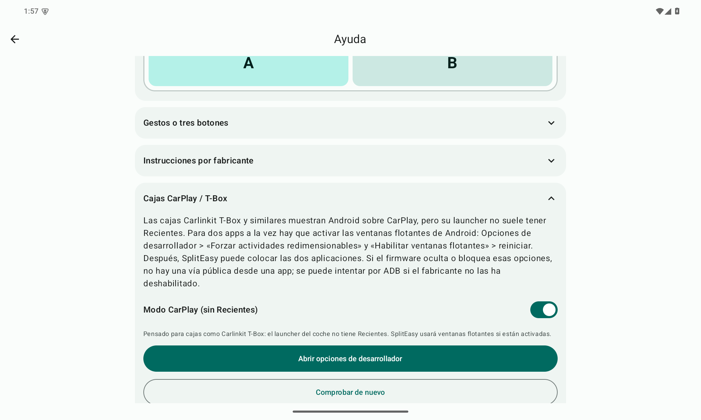

# SplitEasy

Aplicación Android de código abierto para preparar y abrir dos aplicaciones en
pantalla dividida con el menor número de pasos posible. Está pensada para
personas que no saben cómo llegar a las aplicaciones recientes o al modo
multiventana del sistema.

[Descargar el APK](https://github.com/sasogu/SplitEasy/releases/latest) ·
Android 10 o posterior · Sin permisos de usuario · Sin conexión · Licencia MIT



| Selector de aplicaciones | Guía manual | Ayuda |
| --- | --- | --- |
|  |  |  |

| Parejas guardadas | Confirmación | Valenciano |
| --- | --- | --- |
|  |  |  |

| Modo CarPlay | Ventanas flotantes | Ayuda CarPlay |
| --- | --- | --- |
|  |  |  |

## Qué hace y qué no hace

SplitEasy puede:

- Listar las aplicaciones que tienen icono en el lanzador, sin pedir
  `QUERY_ALL_PACKAGES`.
- Elegir una aplicación para cada mitad y guardar la pareja.
- Crear un acceso directo anclado en la pantalla de inicio.
- Intentar la apertura en ventanas flotantes cuando el dispositivo declara
  `FEATURE_FREEFORM_WINDOW_MANAGEMENT` o cuando el usuario activa las ventanas
  flotantes en Opciones de desarrollador.
- Modo CarPlay para cajas como Carlinkit T-Box, que no tienen Recientes.
- Guiar paso a paso cuando la apertura automática no es posible, con
  instrucciones adaptadas a Samsung, Xiaomi/Redmi/POCO, Motorola, Pixel y
  Android genérico.
- Detectar de forma aproximada si se usan gestos o tres botones y permitir
  corregirlo.

SplitEasy **no** puede, con APIs públicas, colocar dos aplicaciones arbitrarias
en pantalla dividida. Android reserva ese control al sistema. La aplicación no
usa reflexión, accesibilidad, root ni permisos especiales, y no afirma que un
dispositivo sea compatible basándose solo en su versión de Android. Para el modo
experimental de ventanas usa también una clave serializada de `ActivityOptions`
que Android mantiene estable desde Android 10; está documentada en
[`docs/LIMITATIONS.md`](docs/LIMITATIONS.md).

## Estado del proyecto

Versión **0.1.1**. Probada en emuladores Android 10 (API 29) y Android 15
(API 35) con el APK release, incluidas dos ventanas flotantes reales en ambos.
No se ha probado todavía en una caja T-Box física ni en teléfonos de cada
fabricante. La matriz y la evidencia están en
[`docs/COMPATIBILITY.md`](docs/COMPATIBILITY.md),
[`docs/TESTING.md`](docs/TESTING.md) y
[`docs/CARPLAY.md`](docs/CARPLAY.md).

## Instalación

1. Descarga `SplitEasy-0.1.1.apk` desde
   [Releases](https://github.com/sasogu/SplitEasy/releases/latest).
2. Permite instalar aplicaciones desconocidas para el navegador o el gestor de
   archivos cuando Android lo pregunte.
3. Abre el APK e instala.

Alternativamente, con `adb`:

```bash
adb install -r SplitEasy-0.1.1.apk
```

El APK de distribución está firmado con una clave propia. El SHA-256 de cada
versión aparece en las notas de la release. Requisitos: Android 10 (API 29) o
posterior.

## Uso en cuatro pasos

1. Toca **Primera mitad** y elige una aplicación.
2. Toca **Segunda mitad** y elige otra.
3. Pulsa **Abrir las dos**.
4. Sigue la guía. Si el dispositivo admite ventanas flotantes, SplitEasy
   intentará abrirlas y preguntará si han aparecido las dos. Si no, mostrará los
   pasos del sistema: abrir las dos aplicaciones, abrir Recientes, mantener
   pulsado el icono de una aplicación, elegir «Pantalla dividida» y escoger la
   otra.

### Indicador de modo disponible

| Indicador | Significado | Comportamiento |
| --- | --- | --- |
| **Pantalla dividida compatible** | Se ha observado o confirmado una pantalla dividida real en este dispositivo. | Se ofrece la guía y se recuerda la confirmación. |
| **Multiventana compatible** | El dispositivo declara ventanas flotantes. | Se intenta abrir cada aplicación con límites de ventana. |
| **Apertura asistida** | No hay una vía pública para automatizar la pareja. | Se muestran los pasos del sistema adaptados al fabricante. |
| **Multiventana no disponible o no confirmada** | No hay indicios suficientes (por ejemplo, poca RAM) y no se ha confirmado. | Se ofrece la guía manual sin prometer compatibilidad. |

La compatibilidad se aprende en el propio dispositivo: si SplitEasy entra en
multiventana, o si el usuario confirma que ha abierto las dos aplicaciones, el
indicador se actualiza. Se puede restablecer desde **Ayuda > Opciones
avanzadas**.

### Favoritos y accesos directos

- **Guardar pareja** almacena la pareja en el dispositivo.
- Tocar una pareja guardada la abre; el menú permite cargarla en los paneles,
  crear un acceso directo o eliminarla.
- El acceso directo usa `ShortcutManagerCompat` y la API oficial de shortcuts
  anclados. Si el lanzador no lo permite, la aplicación lo indica. En los
  dispositivos donde no se puede automatizar la apertura, el acceso directo
  abre la guía de esa pareja.

### Idiomas y accesibilidad

- Castellano por defecto y valenciano en `values-va`.
- En Android 13 o posterior, el valenciano se puede escoger en **Ajustes del
  sistema > Aplicaciones > SplitEasy > Idioma**.
- Botones grandes, textos con recursos, contenido descrito para lectores de
  pantalla y adaptación a pantallas grandes y orientación horizontal.
- La pantalla de ayuda incluye esquemas de la pantalla dividida, del gesto de
  Recientes y de la navegación con tres botones.

## CarPlay y cajas T-Box

Las cajas Carlinkit T-Box y similares muestran Android sobre CarPlay, pero su
launcher no tiene Recientes. Para abrir dos aplicaciones a la vez hay que usar
ventanas flotantes:

1. Activa Opciones de desarrollador: Ajustes → Acerca de → toca 7 veces
   «Número de compilación».
2. En Opciones de desarrollador activa **Forzar actividades redimensionables** y
   **Habilitar ventanas flotantes**.
3. Reinicia la caja.
4. Abre SplitEasy → Ayuda → **Cajas CarPlay / T-Box** y comprueba que el
   diagnóstico muestra la opción de desarrollador y «Forzar redimensionables»
   en **Sí**. Activa **Modo CarPlay** si no se activó solo.
5. Elige las dos aplicaciones y pulsa **Abrir las dos** → **Abrir en dos
   ventanas**.

Si tu firmware no muestra Opciones de desarrollador, la guía de la app incluye
los comandos ADB:

```bash
adb shell settings put global enable_freeform_support 1
adb shell settings put global force_resizable_activities 1
adb reboot
```

Estas opciones son una función del sistema Android, no de SplitEasy. Si el
firmware las bloquea, ninguna aplicación instalable puede forzar dos apps lado a
lado. En una caja T-Box real esta ruta está pendiente de validación; en el
emulador Android 15 se han abierto dos ventanas flotantes con límites y sin
Recientes. Detalles en [`docs/CARPLAY.md`](docs/CARPLAY.md).

## Privacidad

- No solicita permisos de usuario. No tiene permiso de Internet.
- No usa anuncios, telemetría, servidores ni cuentas.
- No usa servicios de accesibilidad, root ni shell. En el modo de ventanas usa
  una clave serializada interna de `ActivityOptions` (documentada); no pide
  permisos especiales.
- Solo consulta las aplicaciones visibles mediante una firma `<queries>` de
  `MAIN`/`LAUNCHER`. No usa `QUERY_ALL_PACKAGES`.
- Las parejas se guardan en `SharedPreferences` local. La copia de seguridad de
  Android está desactivada y las reglas de extracción excluyen todos los datos.
- No puede leer el contenido de otras aplicaciones.

El único permiso declarado en el APK es
`es.sasogu.spliteasy.DYNAMIC_RECEIVER_NOT_EXPORTED_PERMISSION`, una permiso
interno de firma que añade AndroidX; no se muestra al usuario ni da acceso a
datos.

## Compilación

Requisitos:

- JDK 17 o posterior.
- Android SDK con la plataforma 35 y Build Tools 35.
- Gradle Wrapper incluido (Gradle 8.12).

```bash
./gradlew :app:assembleDebug
./gradlew :app:testDebugUnitTest
./gradlew :app:lintDebug
```

APK de depuración:

```text
app/build/outputs/apk/debug/app-debug.apk
```

APK de distribución (requiere `keystore.properties`, ver abajo):

```bash
./gradlew :app:assembleRelease
```

```text
app/build/outputs/apk/release/app-release.apk
```

### Firma de distribución

El repositorio no contiene claves. Crea un keystore fuera del proyecto y un
`keystore.properties` local (incluido en `.gitignore`):

```properties
storeFile=/ruta/absoluta/spliteasy-release.jks
storePassword=...
keyAlias=spliteasy
keyPassword=...
```

Sin ese archivo, `assembleRelease` genera un APK sin firmar. Para comprobar la
firma:

```bash
apksigner verify --print-certs app/build/outputs/apk/release/app-release.apk
```

La clave de la versión 0.1.1 está guardada fuera del repositorio en `pass`
(`spliteasy/android-keystore.jks.b64` y
`spliteasy/android-keystore-password`). No se debe perder: sin ella no se pueden
publicar actualizaciones instalables sobre la misma aplicación.

## Estructura

```text
app/src/main/java/es/sasogu/spliteasy/
├── MainActivity.kt              # actividad única, intents de accesos directos
├── SplitEasyApp.kt              # contenedor manual de dependencias
├── data/                        # apps instaladas, favoritos, capacidad, shortcuts
├── domain/                      # lógica pura y comprobable en JVM
├── ui/                          # Compose, estado y pantallas
└── ui/theme/                    # colores y tema Material 3
```

La lógica de capacidad, los límites de ventana, la búsqueda, el detector de
fabricante y el códec de favoritos son independientes de Android y tienen
pruebas unitarias. La interfaz sigue un MVVM sencillo con
`SplitEasyViewModel` y `StateFlow`.

## Pruebas

- 38 pruebas unitarias de JVM: capacidad, límites de ventana, navegación,
  fabricantes, búsqueda y persistencia de parejas.
- Verificación manual en emuladores API 29 y API 35, navegación por gestos y
  tres botones, idiomas, tableta y acceso directo anclado.

Consulta [`docs/TESTING.md`](docs/TESTING.md) para el plan completo y lo que
queda pendiente.

## Documentación

- [`docs/COMPATIBILITY.md`](docs/COMPATIBILITY.md): matriz por versión y
  fabricante, con lo comprobado y lo orientativo.
- [`docs/LIMITATIONS.md`](docs/LIMITATIONS.md): análisis de las APIs públicas,
  APIs ocultas descartadas y límites reales.
- [`docs/CARPLAY.md`](docs/CARPLAY.md): guía específica para cajas CarPlay/T-Box.
- [`docs/TESTING.md`](docs/TESTING.md): pruebas automatizadas, manuales y
  resultados de la versión 0.1.1.

## Dependencias principales

- Kotlin 2.1.0, Jetpack Compose con Material 3 y AndroidX.
- `ShortcutManagerCompat` para accesos directos.
- Sin librerías de red, publicidad, analítica ni inyección de dependencias.

AndroidX y Jetpack Compose se distribuyen con licencia Apache 2.0. Los iconos de
Material se usan a través de `material-icons-core`.

## Licencia

Copyright (c) 2026 Samuel Soriano. Distribuido bajo la licencia
[MIT](LICENSE).

Las rutas de menús de fabricantes son orientativas y pueden cambiar según el
modelo y la versión. SplitEasy no inventa opciones de configuración: cuando no
puede verificar una ruta, ofrece los pasos generales de Android y remite a la
ayuda del dispositivo.
